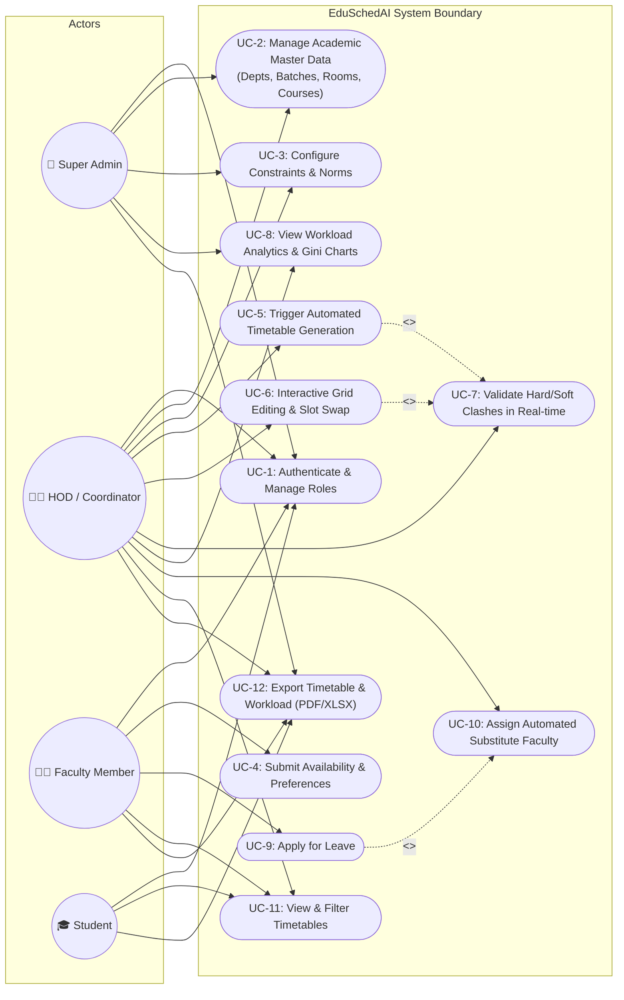
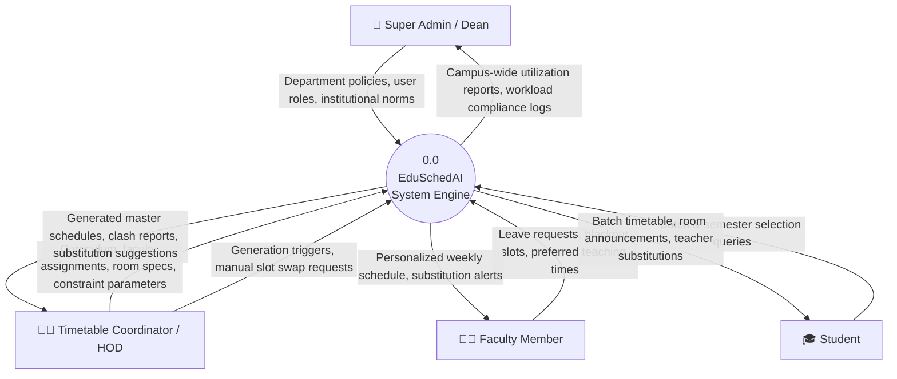
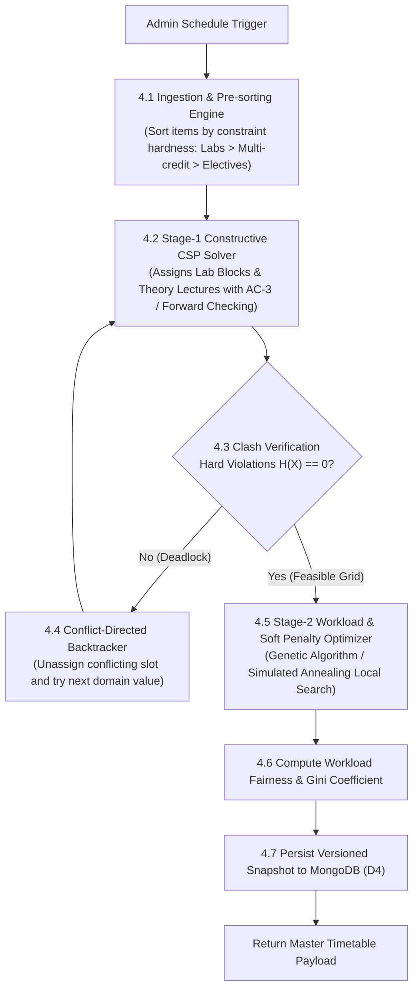
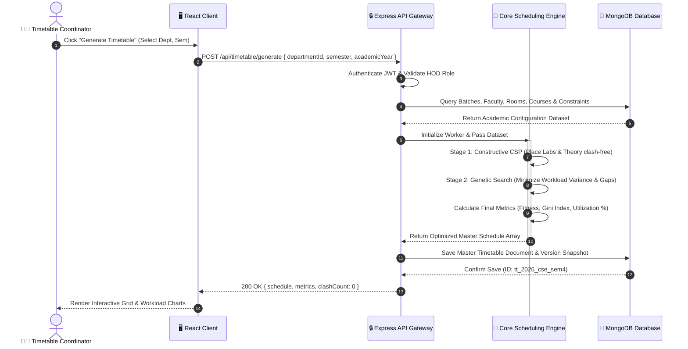
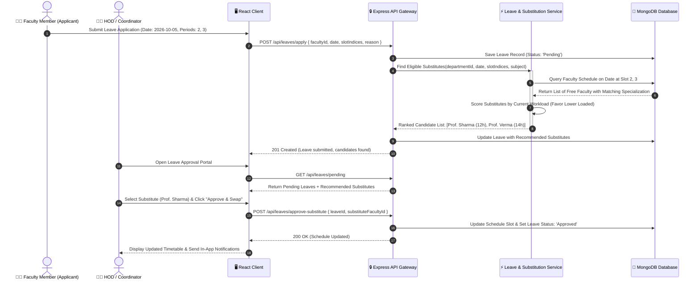
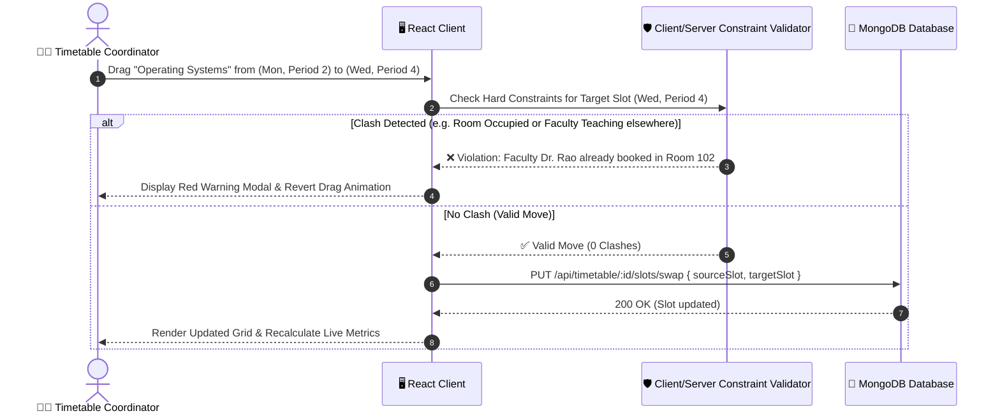

# Phase 2: Data Flow Diagrams & Use-Case Modeling
**Project:** Intelligent Timetable and Faculty Workload Management System (EduSchedAI)  
**Technology Stack:** MERN (MongoDB, Express.js, React.js, Node.js)  
**Document Version:** 1.0.0  

---

## 1. UML Use-Case Model

The use-case model defines the interactions between the system and its primary human actors: **Super Admin**, **Department HOD / Timetable Coordinator**, **Faculty Member**, and **Student**.



---

## 2. Data Flow Diagrams (DFD)

### 2.1 DFD Level 0: System Context Diagram

The Level 0 Context Diagram establishes the boundary between the EduSchedAI core system and external entities.



---

### 2.2 DFD Level 1: System Process Decomposition

The Level 1 DFD decomposes the system into 8 foundational data-processing modules.

```mermaid
graph TB
    subgraph External_Entities
        E_HOD["HOD / Coordinator"]
        E_Faculty["Faculty Member"]
        E_Student["Student"]
    end

    subgraph Processes["System Processes"]
        P1["1.0 Auth & Access Control"]
        P2["2.0 Academic Master Data Mgmt"]
        P3["3.0 Constraint & Preference Mgmt"]
        P4["4.0 Automated Scheduling Core"]
        P5["5.0 Interactive Grid & Manual Overrides"]
        P6["6.0 Workload Balancing & Analytics"]
        P7["7.0 Dynamic Leave & Substitution"]
        P8["8.0 Document Export & Reporting"]
    end

    subgraph Data_Stores[("MongoDB Data Stores")]
        D1[("D1: Users & Roles")]
        D2[("D2: Academic Master Store")]
        D3[("D3: Constraints & Preferences")]
        D4[("D4: Master Timetables")]
        D5[("D5: Workload & Audit Store")]
        D6[("D6: Leaves & Substitutions")]
    end

    %% Process 1
    E_HOD & E_Faculty & E_Student -->|Login Credentials| P1
    P1 <-->|Verify Tokens & Roles| D1
    P1 -->|Auth Session| E_HOD & E_Faculty & E_Student

    %% Process 2
    E_HOD -->|Depts, Rooms, Courses, Batches| P2
    P2 <-->|CRUD Operations| D2

    %% Process 3
    E_HOD -->|Global Hard/Soft Constraints| P3
    E_Faculty -->|Leave / Time Preferences| P3
    P3 <-->|Store / Retrieve Rules| D3

    %% Process 4
    E_HOD -->|Trigger Schedule Request| P4
    D2 & D3 -->|Fetch Academic Data & Rules| P4
    P4 -->|Store Clash-Free Master Schedule| D4
    P4 -->|Write Workload Metrics| D5
    P4 -->|Notify Completion| E_HOD

    %% Process 5
    E_HOD -->|Drag-and-Drop Slot Move| P5
    P5 <-->|Validate & Update Slot| D4
    P5 -->|Live Clash Feedback| E_HOD

    %% Process 6
    D4 & D5 -->|Query Workload Logs| P6
    P6 -->|Render Variance & Gini Metrics| E_HOD

    %% Process 7
    E_Faculty -->|Submit Leave Form| P7
    P7 <-->|Check Free Eligible Faculty| D4
    P7 <-->|Record Substitution| D6
    P7 -->|Substitution Suggestion| E_HOD
    P7 -->|Update Notification| E_Faculty

    %% Process 8
    E_HOD & E_Faculty & E_Student -->|Export Request| P8
    D4 & D5 -->|Retrieve Timetable Data| P8
    P8 -->|Stream PDF / Excel File| E_HOD & E_Faculty & E_Student
```

---

### 2.3 DFD Level 2: Core Scheduling Engine (Sub-process 4.0)



---

## 3. UML Sequence Diagrams

### 3.1 Automated Timetable Generation Flow



---

### 3.2 Dynamic Leave & Automated Substitution Flow



---

### 3.3 Drag-and-Drop Slot Move with Real-time Clash Validation


