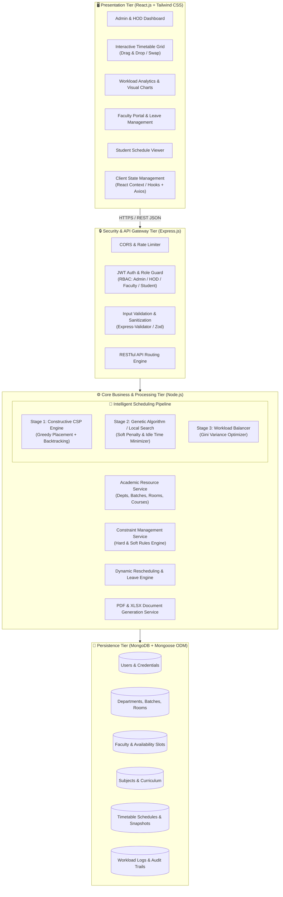

# Phase 2: System Architecture Design
**Project:** Intelligent Timetable and Faculty Workload Management System (EduSchedAI)  
**Technology Stack:** MERN (MongoDB, Express.js, React.js, Node.js)  
**Document Version:** 1.0.0  

---

## 1. Architectural Overview

EduSchedAI is designed around a **Modern 3-Tier Layered Architecture** powered by the **MERN stack**, optimized for high responsiveness, horizontal scalability, and non-blocking asynchronous optimization of complex timetabling operations.



---

## 2. Tier-by-Tier Architectural Breakdown

### 2.1 Presentation Tier (Client - React.js)
- **Framework:** React.js (v18+) with Functional Components and Hooks.
- **Styling & Design System:** Tailwind CSS with a clean, modern design token system, responsive grid layouts, and Lucide React icons.
- **Key Client Components:**
  1. **Master Timetable Matrix (`TimetableGrid`):** Interactive, color-coded weekly calendar grid rendering sessions across days and time periods with drag-and-drop manual reassignment and real-time clash alerts.
  2. **Workload Radar & Bar Charts (`WorkloadAnalytics`):** Visual analytics showing credit hour distributions, theory-to-lab ratios, and faculty allocation variances.
  3. **Resource Management Tables (`FacultyManager`, `RoomManager`, `SubjectManager`):** Data tables with filtering, sorting, pagination, and modal forms.
  4. **Leave & Substitution Portal (`LeaveManager`):** Faculty leave application interface and coordinator substitution recommendation view.
- **State Management & Network Layer:**
  - Axios HTTP client configured with centralized request/response interceptors for automatic JWT attachment and error handling.
  - React Context API for global Authentication and Active Academic Session states.

---

### 2.2 API & Security Tier (Server - Express.js)
- **Routing Engine:** Express RESTful routers segregated by domain resource (`/api/auth`, `/api/faculty`, `/api/rooms`, `/api/subjects`, `/api/batches`, `/api/timetable`, `/api/workload`, `/api/leaves`).
- **Middleware Pipeline:**
  - `cors()`: Cross-Origin Resource Sharing with institutional domain whitelisting.
  - `helmet()`: HTTP security header hardening.
  - `rateLimiter()`: API rate limiting to prevent brute-force attacks and abuse.
  - `authenticateToken()`: Verifies Bearer JWT tokens extracted from HTTP Authorization headers.
  - `requireRole(roles)`: Role-Based Access Control enforcing strict authorization matrices (Super Admin, HOD, Faculty, Student).
  - `validateRequest()`: Schema validation preventing malformed or out-of-range constraint parameters.

---

### 2.3 Core Processing Tier (Scheduling & Optimization Engine)

Timetable generation uses a **Decoupled Two-Stage Hybrid Optimization Pipeline** executed asynchronously in Node.js:

```mermaid
flowchart TD
    Start([Admin Triggers Generation Request]) --> FetchData[Fetch Department Batches, Faculty, Rooms & Constraints from MongoDB]
    FetchData --> Preprocess[Pre-processing: Sort Courses by Constraint Tightness\n(Labs > Multi-credit Theory > Single credits)]
    
    subgraph Stage1["Stage 1: Feasibility Solver (Constructive CSP)"]
        InitGrid[Initialize Empty Multi-Dimensional Grid\nDays × Periods × Batches]
        PlaceLabs[Allocate Multi-Hour Lab Blocks in Specialized Labs]
        PlaceTheory[Assign Theory Lectures using Forward Checking & Minimum Remaining Values]
        CheckHard{All Hard Constraints Satisfied?\nH(X) = 0}
        Backtrack[Backtrack & Reassign Domain Slot]
        PlaceLabs --> PlaceTheory
        PlaceTheory --> CheckHard
        CheckHard -- No --> Backtrack
        Backtrack --> PlaceTheory
    end

    subgraph Stage2["Stage 2: Quality & Workload Optimization (Genetic / Local Search)"]
        PopGen[Generate Population of Feasible Variants]
        EvalFitness[Evaluate Multi-Objective Fitness Function\nS(X) + Workload Variance σ²]
        CrossoverMutate[Apply Conflict-Preserving Mutation & Slot Swaps]
        CheckConvergence{Max Iterations Reached OR\nFitness Threshold Met?}
        PopGen --> EvalFitness --> CrossoverMutate --> CheckConvergence
        CheckConvergence -- No --> EvalFitness
    end

    subgraph Stage3["Stage 3: Persistence & Notification"]
        SaveSnapshot[Save Timetable Document Snapshot to MongoDB]
        CalcMetrics[Compute Final Faculty Workload & Room Utilization Stats]
        NotifyClient[Return Formatted Master Timetable Payload to Client]
    end

    CheckHard -- Yes: Feasible Baseline Found --> PopGen
    CheckConvergence -- Yes --> SaveSnapshot --> CalcMetrics --> NotifyClient --> End([Render Interactive Calendar in React])
```

---

### 2.4 Data Tier (MongoDB + Mongoose ODM)
- **Document Model Rationale:** Unlike rigid relational tables that require complex multi-table JOINs across thousands of weekly cell allocations, MongoDB’s JSON/BSON document model naturally represents:
  - Nested weekly time grids (`days -> periods -> session details`).
  - Faculty availability bitmasks / preference matrices.
  - Historical timetable version snapshots for semester auditing.
- **Indexing Strategy:** Compound indexes on `{ departmentId: 1, academicYear: 1, semester: 1 }` and `{ facultyId: 1, day: 1, slot: 1 }` for sub-millisecond query performance.

---

## 3. Asynchronous Execution & Non-Blocking Architecture

Combinatorial schedule generation for large departments (e.g., 8 batches, 40 faculty members, 60 courses) can take between 5 to 25 seconds. To ensure the Node.js main event loop remains non-blocking:

1. **Async Worker Threads / SetImmediate Chunking:** The CPU-intensive heuristic solver runs asynchronously using either Node.js `worker_threads` or non-blocking cooperative time-slicing (`setImmediate()`), preventing API request starvation for other concurrent users.
2. **Progressive Status Feedback:** For long generation cycles, the API provides task status updates so the React frontend displays live progress indicators (e.g., *Phase 1: Placing Laboratories (30%)... Phase 2: Optimizing Workloads (85%)...*).

---

## 4. System Security & Role-Based Access Control (RBAC)

```
                            RBAC Privilege Matrix
 ┌───────────────────────────┬──────────────┬──────────────┬──────────────┬──────────────┐
 │ Functional Capability     │ Super Admin  │ HOD / Coord  │ Faculty      │ Student      │
 ├───────────────────────────┼──────────────┼──────────────┼──────────────┼──────────────┤
 │ Manage Depts & Curricula  │ Full (CRUD)  │ Read / Edit  │ Read-only    │ Read-only    │
 │ Manage Faculty & Rooms    │ Full (CRUD)  │ Full (CRUD)  │ Read-only    │ Read-only    │
 │ Trigger Algorithm Gen     │ Full Access  │ Full Access  │ No Access    │ No Access    │
 │ Manual Slot Drag & Drop   │ Full Access  │ Full Access  │ No Access    │ No Access    │
 │ Submit Slot Preferences   │ No Access    │ Optional     │ Full Access  │ No Access    │
 │ Apply for Leave           │ No Access    │ Optional     │ Full Access  │ No Access    │
 │ Assign Leave Substitute   │ Full Access  │ Full Access  │ Self-Accept  │ No Access    │
 │ View Batch Timetables     │ Full Access  │ Full Access  │ Full Access  │ Full Access  │
 │ Export PDF / Excel        │ Full Access  │ Full Access  │ Personalized │ Batch Only   │
 └───────────────────────────┴──────────────┴──────────────┴──────────────┴──────────────┘
```
