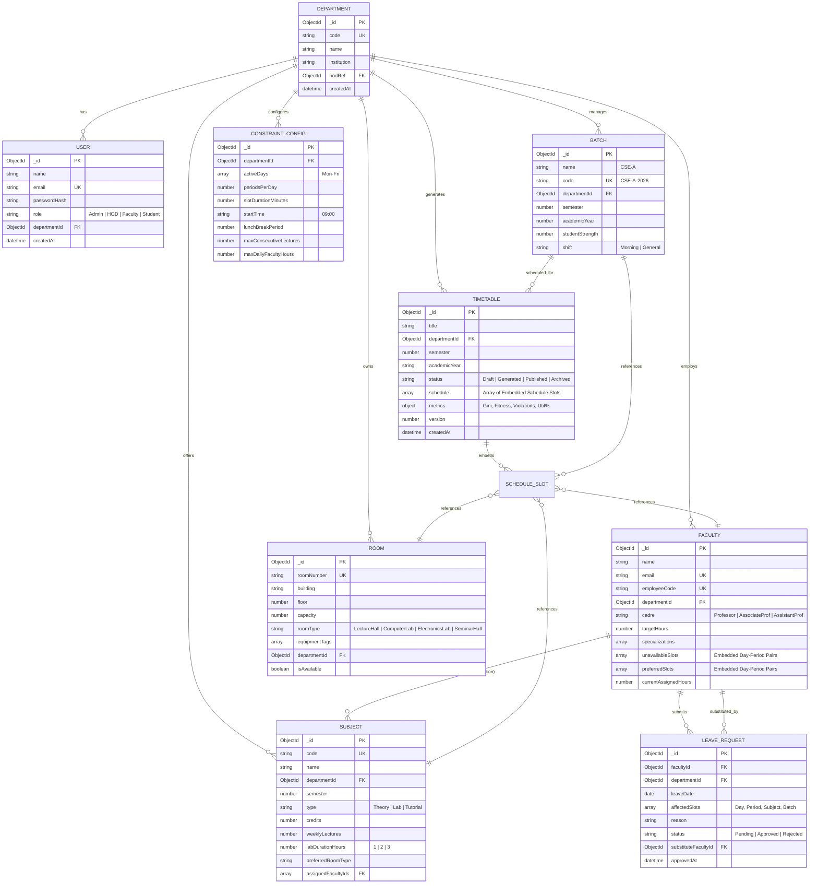

# Phase 3: Database Design & Setup
**Project:** Intelligent Timetable and Faculty Workload Management System (EduSchedAI)  
**Database System:** MongoDB (v6.0+) with Mongoose ODM  
**Document Version:** 1.0.0  

---

## 1. Database Architecture & Modeling Strategy

EduSchedAI utilizes **MongoDB** for persistence. The database design adopts a **Hybrid Hybrid Referencing & Embedding Model**:
1. **Normalized Document References (ObjectIds):** Used for core master entities (`Department`, `Faculty`, `Room`, `Subject`, `Batch`, `User`) to maintain strict referential integrity, eliminate duplicate updates, and support relational queries.
2. **Denormalized Embedded Subdocuments:** Used for time slots (`schedule` entries inside `Timetable`), faculty blackout matrices (`unavailableSlots`), and substitution logs inside `LeaveRequest` to optimize read performance and allow single-document atomic updates.

---

## 2. Entity-Relationship (ER) Diagram



---

## 3. Data Dictionary & Collection Specifications

### 3.1 `departments` Collection
Stores academic departments and organizational metadata.

| Field | Type | Required | Unique | Description |
| :--- | :--- | :--- | :--- | :--- |
| `_id` | `ObjectId` | Yes | Yes | Primary Key |
| `code` | `String` | Yes | Yes | Short identifier (e.g., `"CSE"`, `"ECE"`) |
| `name` | `String` | Yes | No | Full Department Name (e.g., `"Computer Science & Engineering"`) |
| `institution`| `String` | Yes | No | Parent University / College Name |
| `hodRef` | `ObjectId` | No | No | Reference to `User` / `Faculty` acting as HOD |
| `createdAt` | `Date` | Yes | No | Auto-generated timestamp |

---

### 3.2 `users` Collection
Stores authentication credentials and RBAC access permissions.

| Field | Type | Required | Unique | Description |
| :--- | :--- | :--- | :--- | :--- |
| `_id` | `ObjectId` | Yes | Yes | Primary Key |
| `name` | `String` | Yes | No | Full name |
| `email` | `String` | Yes | Yes | Login email address (indexed) |
| `password` | `String` | Yes | No | bcrypt hashed password string (min salt rounds = 10) |
| `role` | `String` | Yes | No | Enum: `['Admin', 'HOD', 'Faculty', 'Student']` |
| `departmentId` | `ObjectId` | No | No | Reference to `departments` collection |
| `facultyRef` | `ObjectId` | No | No | Optional reference to linked `faculties` document |

---

### 3.3 `faculties` Collection
Stores instructor profiles, workload targets, and constraint availability.

| Field | Type | Required | Description |
| :--- | :--- | :--- | :--- |
| `_id` | `ObjectId` | Yes | Primary Key |
| `name` | `String` | Yes | Instructor Name (e.g., `"Dr. Aris Thorne"`) |
| `email` | `String` | Yes | Contact Email (indexed) |
| `employeeCode`| `String` | Yes | Unique Employee ID (e.g., `"FAC-CSE-001"`) |
| `departmentId`| `ObjectId` | Yes | Ref to `departments` |
| `cadre` | `String` | Yes | Enum: `['Professor', 'AssociateProf', 'AssistantProf']` |
| `targetHours` | `Number` | Yes | Target weekly teaching hours (e.g., 14 for Prof, 18 for AsstProf)|
| `specializations`| `[String]` | No | Array of subject domains (e.g., `["Algorithms", "Databases"]`) |
| `unavailableSlots`| `Array` | No | Array of `{ day: String, period: Number, reason: String }` |
| `preferredSlots`| `Array` | No | Array of `{ day: String, period: Number, weight: Number }` |
| `currentAssignedHours`| `Number` | No | Denormalized count of current active semester teaching hours |

---

### 3.4 `rooms` Collection
Stores physical venues (Lecture halls, Computer labs, Hardware labs).

| Field | Type | Required | Description |
| :--- | :--- | :--- | :--- |
| `_id` | `ObjectId` | Yes | Primary Key |
| `roomNumber` | `String` | Yes | Room identifier (e.g., `"LH-101"`, `"LAB-CS-2"`) |
| `building` | `String` | Yes | Building / Block Name |
| `floor` | `Number` | Yes | Floor number (0 = Ground, 1 = 1st Floor) |
| `capacity` | `Number` | Yes | Maximum seating capacity (e.g., 70) |
| `roomType` | `String` | Yes | Enum: `['LectureHall', 'ComputerLab', 'HardwareLab', 'SeminarHall']` |
| `equipmentTags`| `[String]` | No | Capabilities (e.g., `["Projector", "Workstations", "GPU_Cluster"]`) |
| `departmentId`| `ObjectId` | Yes | Ref to `departments` |
| `isAvailable` | `Boolean` | Yes | Operational availability status (default: `true`) |

---

### 3.5 `subjects` Collection
Stores courses, curricula, weekly credit hours, and laboratory attributes.

| Field | Type | Required | Description |
| :--- | :--- | :--- | :--- |
| `_id` | `ObjectId` | Yes | Primary Key |
| `code` | `String` | Yes | Subject code (e.g., `"CS401"`, `"CS402P"`) |
| `name` | `String` | Yes | Subject Title (e.g., `"Design & Analysis of Algorithms"`) |
| `departmentId`| `ObjectId` | Yes | Ref to `departments` |
| `semester` | `Number` | Yes | Semester level (e.g., `4`) |
| `type` | `String` | Yes | Enum: `['Theory', 'Lab', 'Tutorial']` |
| `credits` | `Number` | Yes | Academic credit value |
| `weeklyLectures`| `Number` | Yes | Number of discrete weekly class periods (e.g., `4` or `2`) |
| `labDurationHours`| `Number` | No | Continuous hours for lab sessions (default: `1`, for labs `2` or `3`)|
| `preferredRoomType`| `String` | Yes | Enum matching `Room.roomType` |
| `assignedFacultyIds`| `[ObjectId]` | Yes | Array of qualified faculty eligible to teach this course |

---

### 3.6 `batches` Collection
Stores student cohorts and sections.

| Field | Type | Required | Description |
| :--- | :--- | :--- | :--- |
| `_id` | `ObjectId` | Yes | Primary Key |
| `name` | `String` | Yes | Section Name (e.g., `"CSE-A"`) |
| `code` | `String` | Yes | Batch Code (e.g., `"CSE-A-2026"`) |
| `departmentId`| `ObjectId` | Yes | Ref to `departments` |
| `semester` | `Number` | Yes | Current semester (e.g., `4`) |
| `academicYear`| `String` | Yes | Academic year string (e.g., `"2026-2027"`) |
| `studentStrength`| `Number` | Yes | Enrolled student headcount (e.g., `60`) |
| `shift` | `String` | No | Enum: `['Morning', 'General', 'Evening']` (default: `'General'`) |

---

### 3.7 `constraintconfigs` Collection
Stores global timing rules and operational boundaries for timetable compilation.

| Field | Type | Required | Description |
| :--- | :--- | :--- | :--- |
| `_id` | `ObjectId` | Yes | Primary Key |
| `departmentId` | `ObjectId` | Yes | Ref to `departments` |
| `activeDays` | `[String]` | Yes | Array: `["Monday", "Tuesday", "Wednesday", "Thursday", "Friday"]` |
| `periodsPerDay` | `Number` | Yes | Number of periods per day (default: `7`) |
| `slotDurationMinutes`| `Number` | Yes | Duration of a single period (default: `50` or `60`) |
| `startTime` | `String` | Yes | Daily start time string (e.g., `"09:00"`) |
| `lunchBreakPeriod` | `Number` | Yes | Period index designated for lunch (e.g., `4`) |
| `maxConsecutiveLectures`| `Number` | Yes | Max back-to-back hours per instructor (default: `2`) |
| `maxDailyFacultyHours` | `Number` | Yes | Max teaching hours per day per instructor (default: `4`) |

---

### 3.8 `timetables` Collection
Stores generated master schedule snapshots, cell allocations, and fitness metrics.

| Field | Type | Required | Description |
| :--- | :--- | :--- | :--- |
| `_id` | `ObjectId` | Yes | Primary Key |
| `title` | `String` | Yes | Timetable name (e.g., `"CSE Sem 4 Master Timetable - Fall 2026"`)|
| `departmentId` | `ObjectId` | Yes | Ref to `departments` |
| `semester` | `Number` | Yes | Academic semester |
| `academicYear` | `String` | Yes | Academic year string |
| `status` | `String` | Yes | Enum: `['Draft', 'Generated', 'Published', 'Archived']` |
| `schedule` | `[ScheduleSlot]`| Yes | Array of embedded schedule objects (see below) |
| `metrics` | `Object` | Yes | `{ hardViolations, softPenalty, workloadGiniIndex, executionTimeMs }` |
| `version` | `Number` | Yes | Version iteration integer (default: `1`) |
| `createdAt` | `Date` | Yes | Generation timestamp |

**`ScheduleSlot` Embedded Schema:**
```json
{
  "day": "Monday",
  "period": 1,
  "batchId": "64f1a2b3c4d5e6f7a8b9c0b1",
  "subjectId": "64f1a2b3c4d5e6f7a8b9c0s1",
  "facultyId": "64f1a2b3c4d5e6f7a8b9c0f1",
  "roomId": "64f1a2b3c4d5e6f7a8b9c0r1",
  "type": "Theory",
  "isLabBlock": false,
  "slotDuration": 1
}
```

---

### 3.9 `leaverequests` Collection
Tracks faculty absence applications and substitution workflows.

| Field | Type | Required | Description |
| :--- | :--- | :--- | :--- |
| `_id` | `ObjectId` | Yes | Primary Key |
| `facultyId` | `ObjectId` | Yes | Applicant faculty ref |
| `departmentId` | `ObjectId` | Yes | Ref to `departments` |
| `leaveDate` | `Date` | Yes | Calendar date of leave |
| `affectedSlots` | `[Object]` | Yes | Array of `{ period: Number, subjectId, batchId, roomId }` |
| `reason` | `String` | Yes | Reason for absence |
| `status` | `String` | Yes | Enum: `['Pending', 'Approved', 'Rejected', 'Cancelled']` |
| `substituteFacultyId`| `ObjectId` | No | Assigned substitute instructor ref |
| `recommendedSubstitutes`| `[ObjectId]`| No | Ranked algorithmic suggestions |
| `approvedAt` | `Date` | No | Timestamp of approval |

---

## 4. Indexing & Optimization Strategy

To guarantee high throughput and sub-millisecond retrieval during timetable generation and UI rendering:

```javascript
// Compound Indexes for fast conflict checking & batch querying
BatchSchema.index({ departmentId: 1, semester: 1, code: 1 }, { unique: true });
FacultySchema.index({ departmentId: 1, employeeCode: 1 }, { unique: true });
RoomSchema.index({ departmentId: 1, roomNumber: 1 }, { unique: true });
SubjectSchema.index({ departmentId: 1, code: 1 }, { unique: true });
TimetableSchema.index({ departmentId: 1, semester: 1, academicYear: 1, status: 1 });
LeaveRequestSchema.index({ departmentId: 1, leaveDate: 1, status: 1 });
```
